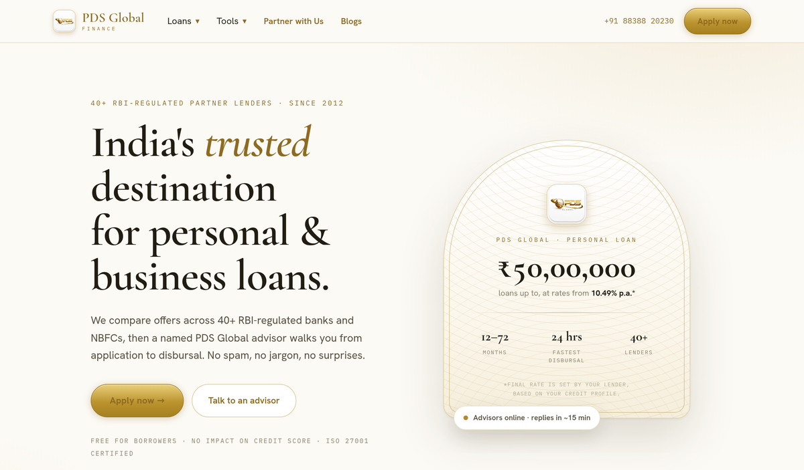
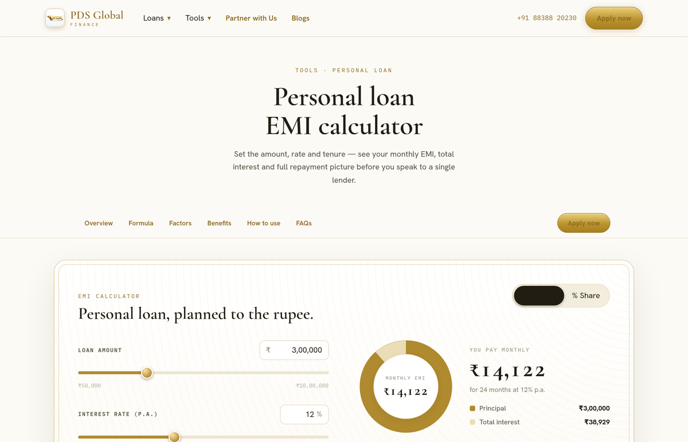
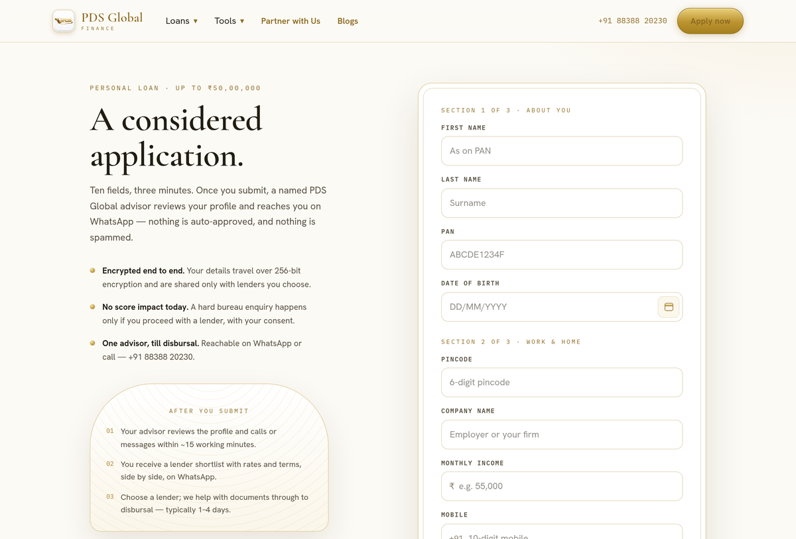
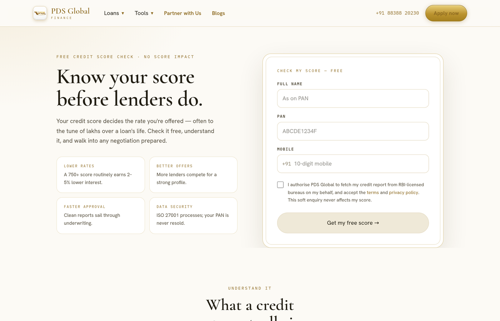
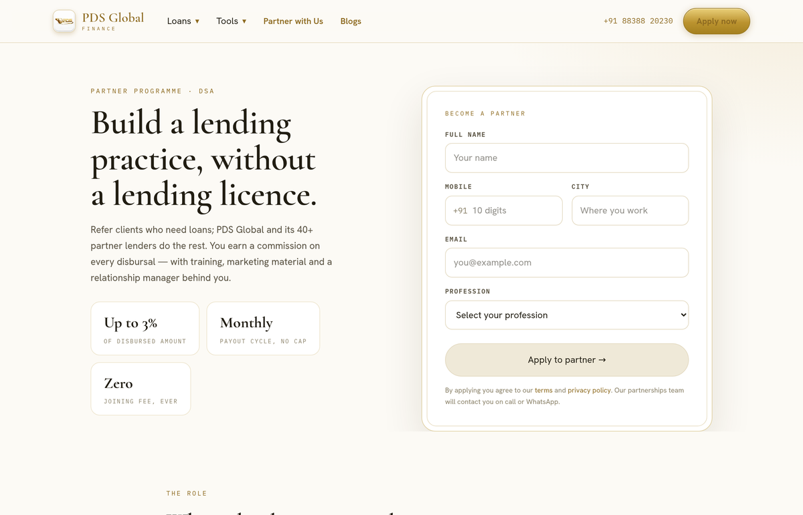
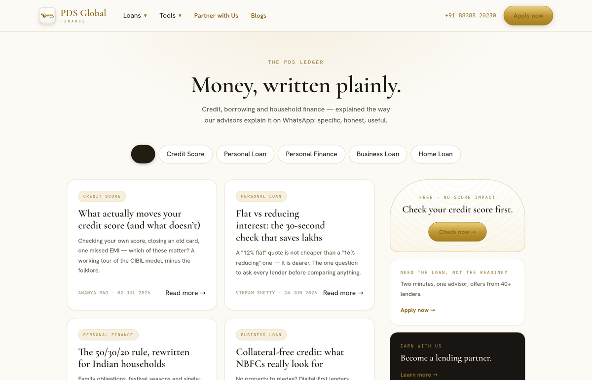
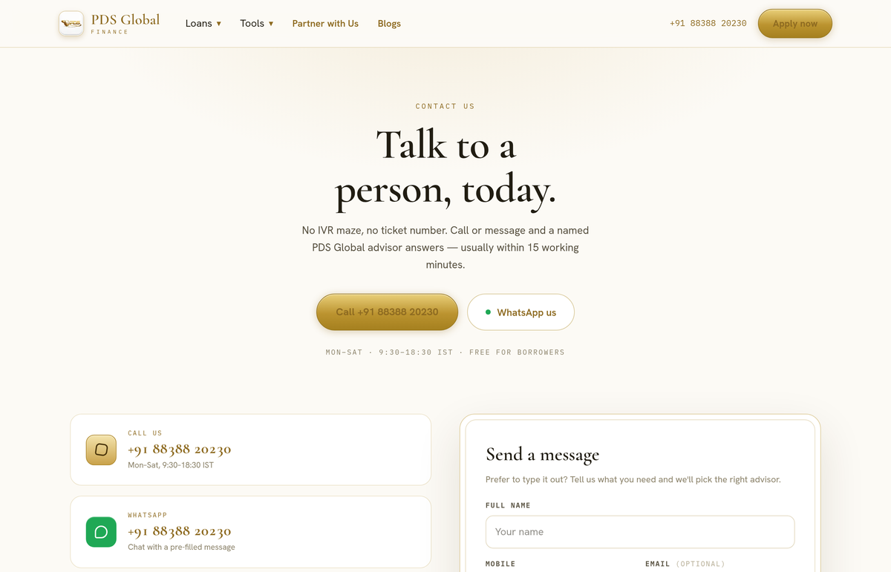
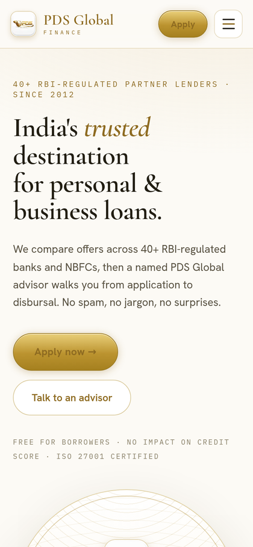
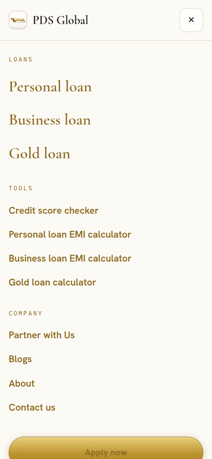
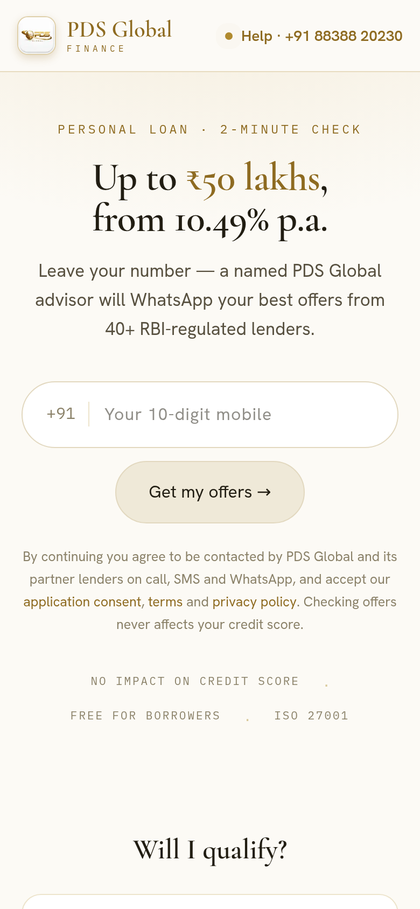

<div align="center">

# PDS Global — Loan Aggregator Platform

**India's trusted destination for personal &amp; business loans.**

The public web platform and lead-capture engine for **PDS Global Financial
Services Pvt. Ltd.** — a loan service provider &amp; direct selling agent for
RBI-regulated banks and NBFCs, operating under the Finance Buddha group.

[](https://nextjs.org/)
[](https://www.typescriptlang.org/)
[](https://tailwindcss.com/)
[](https://www.prisma.io/)
[](https://www.postgresql.org/)
[](LICENSE)



</div>

---

## About the project

PDS Global is a loan aggregator that processes **₹5–7 crore of loan-related
business every month**. This repository is the company's public face and its
primary lead-capture channel: prospective borrowers explore products, estimate
EMIs, check eligibility and submit their details, and every submission funnels
to a **human advisor** over WhatsApp or a phone call.

It was built end-to-end by a three-person team during a full-stack development
internship — from the white-and-gold design system through to the persistence,
validation and notification backend behind every form.

> **It is a lead-capture site, not a lending platform.** There is no automated
> loan approval, bank routing, OTP, credit-bureau pull, KYC verification,
> payment flow or user dashboard. Each form does exactly two things: **persist
> the lead**, then **hand the visitor to a human**. Offers always depend on
> lender eligibility and the applicant's credit profile — never guaranteed.

---

## Screenshots

<table>
  <tr>
    <td width="50%"><br><sub><b>EMI calculator</b> — real amortisation math, live donut split</sub></td>
    <td width="50%"><br><sub><b>Loan application</b> — validated multi-field form</sub></td>
  </tr>
  <tr>
    <td width="50%"><br><sub><b>Credit score checker</b> — capture + education</sub></td>
    <td width="50%"><br><sub><b>Partner (DSA) onboarding</b></sub></td>
  </tr>
  <tr>
    <td width="50%"><br><sub><b>Blog</b> — filterable articles + reader</sub></td>
    <td width="50%"><br><sub><b>Contact</b> — call / WhatsApp conversion endpoint</sub></td>
  </tr>
</table>

<div align="center">
  
  &nbsp;
  
  &nbsp;
  
  <br><sub>Mobile-first throughout — most borrowers arrive on a phone.</sub>
</div>

---

## Features

- **18 fully-built pages** — homepage, quick-apply funnel, full loan
  application, credit-score checker, three EMI calculators, partner onboarding,
  blog, about, contact and six legal pages.
- **Five lead-capture forms**, each validated on the client *and* re-validated
  on the server, funnelling to a pre-filled WhatsApp handoff or click-to-call.
- **Real EMI engine** — `EMI = [P·r·(1+r)ⁿ] / [(1+r)ⁿ − 1]`, guarded against
  zero-interest, empty-input and `Infinity`/`NaN` edge cases, with an
  amount/percentage toggle and a pure-CSS donut split.
- **Server-issued reference codes** (`ML-`, `CS-`, `PT-`, `CT-`, `GR-`) so the
  success screen always shows a genuine, unique code.
- **Pluggable notifications** — email (Resend or SMTP) plus an optional webhook,
  fanned out *after* the response so a provider outage can never break a
  borrower's success state.
- **Anti-abuse** — per-IP and per-mobile rate limiting, honeypot field and
  optional Cloudflare Turnstile.
- **Privacy by design** — IPs stored only as salted hashes; PAN and mobile
  numbers masked in application logs; consent recorded with text version and
  timestamp.
- **Bespoke white-and-gold design system** — a Cormorant Garamond / Hanken
  Grotesk / IBM Plex Mono type trio, metal-leaf gold accents and signature
  arch cards, fully responsive and reduced-motion aware.

---

## Tech stack

| Layer | Choice |
| --- | --- |
| Framework | Next.js 15 (App Router, React 19) |
| Language | TypeScript 5 (strict) |
| Styling | Tailwind CSS 4 |
| Forms &amp; validation | React Hook Form + Zod 4 (schemas shared client ↔ server) |
| Database | PostgreSQL 16 via Prisma 7 (pg driver adapter) |
| Notifications | Resend / Nodemailer SMTP / webhook |
| Rate limiting | Upstash Redis REST, with in-memory fallback |

---

## How a lead flows

```
Borrower fills a form
        │  client-side Zod validation (lib/schemas.ts)
        ▼
POST /api/leads/[type]
        │  re-validate · honeypot · Turnstile · rate limit (IP + mobile)
        ▼
Persist to Postgres  ──▶  server-generated refCode (ML-/CS-/PT-/CT-)
        │                 consent provenance recorded
        ▼
Response { ok, refCode, whatsappUrl }
        │                       │
        ▼                       ▼
Success screen renders     notify() fans out after response
refCode + WhatsApp link    (email / webhook — failures never block)
```

`POST /api/grievance` handles grievance and consent-revocation intake (`GR-`
codes) and notifies the grievance officer, matching the 48-hour acknowledgement
promised on the legal pages.

---

## Getting started

**Prerequisites:** Node 20+, a PostgreSQL database.

```bash
# 1. Install (also runs `prisma generate`)
npm install

# 2. Configure
cp .env.example .env          # set DATABASE_URL (+ IP_HASH_SALT in production)

# 3. Migrate + seed
npx prisma migrate deploy
npm run db:seed               # optional sample leads

# 4. Run
npm run dev                   # http://localhost:3000
```

```bash
npm run build && npm start    # production build
```

### Notifications

So leads reach a human, set **at least one** provider in `.env`:

- **Resend** — `RESEND_API_KEY`
- **SMTP** — `SMTP_HOST`, `SMTP_PORT`, `SMTP_USER`, `SMTP_PASS`
- **Webhook** — `NOTIFY_WEBHOOK_URL` (Telegram/WhatsApp bridge, Slack, Zapier…)

All configuration is env-driven — see [`.env.example`](.env.example) for the
full list. Brand constants (phone, WhatsApp, email, address) live in
[`lib/config.ts`](lib/config.ts) and are never hardcoded in components.

---

## Project structure

```
app/
  (site)/            Pages under the shared header/footer chrome
  apply/             Standalone quick-apply funnel (compact chrome)
  api/
    leads/[type]/    Lead intake — validate, persist, WhatsApp handoff
    grievance/       Grievance & consent-revocation intake
components/          SiteHeader, SiteFooter, EmiCalculator, PartnerGrid…
lib/
  config.ts          Brand constants (env-overridable)
  schemas.ts         Shared client + server Zod validation
  db.ts · notify.ts · rate-limit.ts · refcode.ts · hash.ts · whatsapp.ts
prisma/              Schema, migrations, seed
docs/screenshots/    README assets
```

---

## API reference

| Method | Route | Purpose |
| --- | --- | --- |
| `POST` | `/api/leads/apply` | Quick-apply funnel (mobile only) |
| `POST` | `/api/leads/personal-loan` | Full loan application |
| `POST` | `/api/leads/credit-score` | Credit-score checker |
| `POST` | `/api/leads/partner` | DSA / partner onboarding |
| `POST` | `/api/leads/contact` | Contact message |
| `POST` | `/api/grievance` | Grievance / consent-revocation intake |

Each returns `{ ok, refCode, whatsappUrl }` on success, or a `422` with
field-level `issues` on validation failure.

---

## Compliance

- Never states "guaranteed approval" — offers depend on lender eligibility and
  credit profile.
- Calculators are estimates only, never offers.
- LSP / DSA disclaimer present site-wide; consent recorded with version and
  timestamp; PAN/mobile masked in logs; IPs stored only as salted hashes.

---

## License

Released under the [MIT License](LICENSE).
